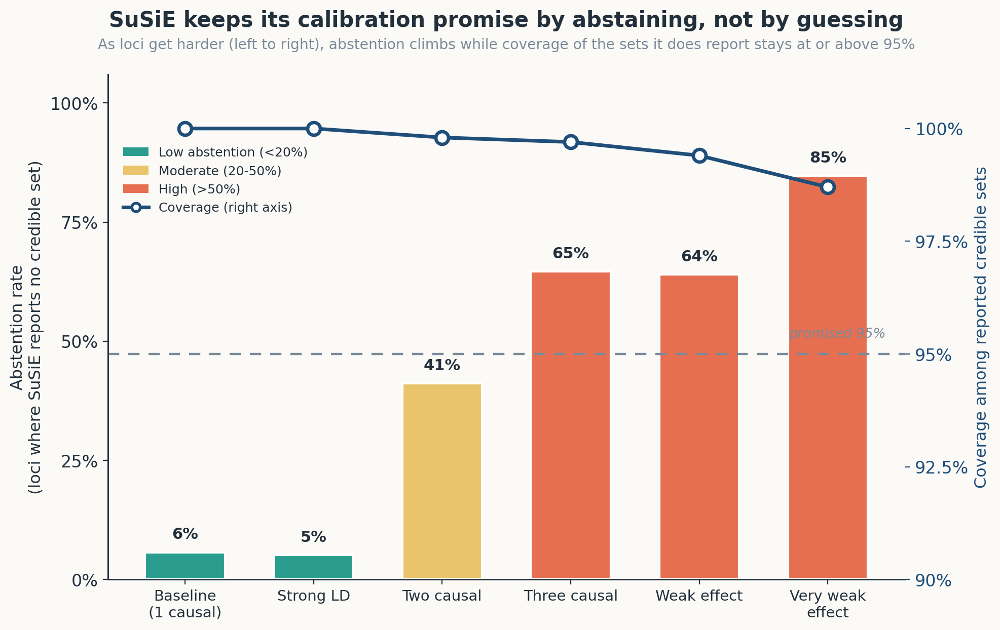
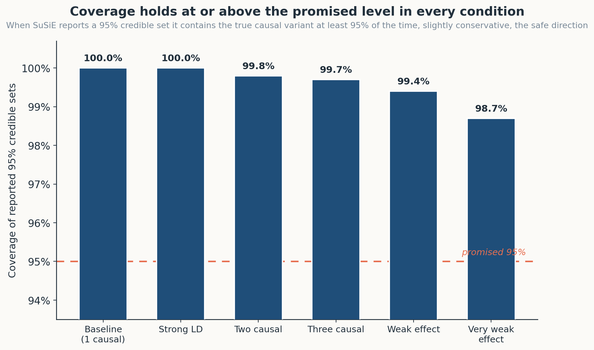

# finemap-calibration-benchmark

> **Does a fine-mapping method keep its central promise? When SuSiE reports a 95% credible set, does it actually contain the true causal variant 95% of the time, and what does it do when it cannot be that confident? This benchmark answers both, by simulation against known ground truth, and finds that SuSiE maintains its calibration by abstaining rather than misleading.**

[](https://www.r-project.org/)
[](https://github.com/stephenslab/susieR)
[](LICENSE)
[](https://github.com/gbadedata/finemap-calibration-benchmark/actions/workflows/tests.yml)

Statistical fine-mapping takes a GWAS-associated locus and tries to pinpoint which variant is actually causal, separating it from the many non-causal variants dragged along by linkage disequilibrium. The leading method, SuSiE, reports its answer as a *credible set*: a small group of variants that, at a stated confidence level such as 95%, should contain the true causal variant.

That stated confidence is a promise. This project measures whether the promise is kept.

It is the third in a series applying one idea, *measure whether a model's stated confidence is honest, not just whether it is accurate*, across very different kinds of model. The first turned that lens on a [large language model interpreting clinical variants](https://github.com/gbadedata/clinvar-interpretation-benchmark); the second on a [variant caller's quality scores](https://github.com/gbadedata/variant-calling-calibration-benchmark). This one turns it on a statistical-genetics method, in the role's core domain.

---

## The headline result

Across thousands of simulated loci with known causal variants, SuSiE-RSS shows two behaviours that together are the whole finding:

| Behaviour | Finding |
|---|---|
| **Calibration holds** | Among loci where SuSiE reports a 95% credible set, the set contains the true causal variant 98.7-100% of the time, at or above the promised 95% in every condition (slightly conservative, the safe direction). |
| **It abstains rather than mislead** | As difficulty rises, SuSiE increasingly reports *no* credible set instead of a wrong one. Abstention climbs from 5-6% on clean loci, to 41% with two causal variants, to 85% in the lowest-power regime. |

The crucial point is the link between the two. The high coverage is not the interesting part on its own, a method can trivially achieve high coverage by returning huge sets. What SuSiE does instead is keep its sets sharp (typically a single variant) and protect the calibration promise by *declining* the loci where it cannot meet it. Coverage stays high **because** the method abstains on the hard cases rather than guessing.

| Condition | Coverage | Abstention |
|---|---|---|
| Baseline (1 causal) | 100.0% | 6% |
| Strong LD | 100.0% | 5% |
| Two causal | 99.8% | 41% |
| Three causal | 99.7% | 65% |
| Weak effect | 99.4% | 64% |
| Very weak effect | 98.7% | 85% |

This is the same disciplined behaviour the companion projects found in a large language model interpreting variants and in a variant caller's quality scores: when the evidence runs out, a well-built method says so rather than fabricating confidence. Demonstrated here in the core domain of statistical genetics.

---

## Why calibration must be measured by simulation

Fine-mapping calibration can only be measured against known ground truth, and on real GWAS data the true causal variant is unknown. That is the entire reason fine-mapping exists. So calibration is measured by simulation: we plant known causal variants in a locus with realistic linkage disequilibrium, generate GWAS summary statistics consistent with that truth, run SuSiE, and check whether its credible sets behave as promised. This is not a shortcut; it is the standard and correct approach, the same one used to validate SuSiE, FiniMOM, SuSiEx, and SuSiE 2.0.

To anchor the simulation to reality, the project also includes a real-locus demonstration on the SORT1 / 1p13 cholesterol locus, where the causal variant is independently known (see below).

---

## Figures

### Calibration is maintained through abstention
The whole finding in one view. As loci get harder (left to right), abstention climbs (bars) while coverage of the credible sets SuSiE does report stays at or above the promised 95% (line).



### Coverage holds at or above the promised level
Among the sets SuSiE reports, coverage sits at or above 95% in every condition, slightly conservative, which is the safe direction.



---

## What the benchmark measures

For each simulated condition (thousands of loci), the framework reports:

- **Empirical coverage**: among loci where a credible set is reported, the fraction whose set contains a true causal variant. The core calibration metric.
- **Calibration gap**: empirical coverage minus the nominal level (here 0.95). Positive is conservative; negative is anti-conservative (the dangerous direction).
- **Mean credible-set size**: resolution. Smaller is sharper.
- **Abstention rate**: the fraction of loci where SuSiE returns no credible set, declining to commit.
- **Credible-set FDR**: the fraction of reported credible sets that contain no true causal variant.

These are computed across conditions that vary the difficulty: number of causal variants, effect size (power), and LD strength.

---

## The conditions and what they reveal

| Condition | What it tests | What happens |
|---|---|---|
| baseline | single causal, clear signal | high coverage, sharp sets, rarely abstains |
| strong LD | tighter proxy correlation | calibration holds |
| two / three causal | multiple signals | coverage holds; abstention rises sharply |
| weak / very weak effect | low power | coverage holds; abstention rises to the majority of loci |

The pattern is consistent: difficulty does not break SuSiE's calibration, it raises its abstention. The method protects the promise by narrowing what it is willing to claim.

---

## The real-locus anchor: SORT1 / 1p13

Calibration must be measured by simulation, but to show the pipeline works on real data, the project uses the textbook fine-mapping success at the SORT1 locus. The causal variant rs12740374 is functionally validated, it creates a C/EBP transcription-factor binding site that alters hepatic SORT1 expression (Musunuru et al., Nature 2010), and has been fine-mapped to posterior inclusion probability above 0.99 in published work.

`R/real_locus.R` is a template that runs SuSiE-RSS on real LDL-cholesterol summary statistics for this locus (user supplies the z-scores and a reference-panel LD matrix) and confirms it recovers rs12740374. This is the analogue of measuring a method on a case where the answer is independently known, the real-data complement to the simulation.

---

## Quick start

```bash
git clone git@github.com:gbadedata/finemap-calibration-benchmark.git
cd finemap-calibration-benchmark

# Install dependencies (susieR, MASS, jsonlite) into your R library
Rscript setup.R

# Fast logic tests (no susieR needed)
Rscript tests/test_calibration.R

# The full benchmark (simulation + SuSiE; a few minutes at 1000 reps)
Rscript R/run_benchmark.R

# Generate the figures from the report
Rscript R/make_figures.R
```

Set `FM_NREP` to change replicates per condition (default 1000): `FM_NREP=300 Rscript R/run_benchmark.R`.

---

## Architecture

```
R/simulate.R      Plant known causal variants in a locus with realistic LD;
                  generate GWAS summary statistics (z-scores) consistent with R.
        |
        v
R/finemap.R       Run SuSiE-RSS (susie_rss); extract credible sets with the
                  purity filter active (Xcorr = R) and PIPs.
        |
        v
R/calibration.R   Recovery and calibration metrics: coverage among reported
                  sets, calibration gap, set size, abstention, credible-set FDR.
        |
        v
R/run_benchmark.R Sweep difficulty conditions; write JSON + summary table.
R/make_figures.R  Render the figures from the report.
R/real_locus.R    Real-data anchor template (SORT1 / 1p13).
```

The calibration measurement logic was prototyped and unit-tested in Python before being ported to R, so the metric arithmetic is known-correct independently of susieR. `tests/test_calibration.R` reproduces those checks in R, including a mock fine-mapper with known coverage that the metric must recover.

---

## Engineering notes

**The purity filter is essential, and easy to miss.** SuSiE's credible-set construction includes a purity filter that prunes sets to variants genuinely correlated with one another. It only runs if the LD matrix is passed to `susie_get_cs(fit, Xcorr = R)`. Without it, credible sets fill with uncorrelated noise and balloon to dozens of variants; with it, they collapse to the genuine signal. This was diagnosed by running single loci through SuSiE and inspecting real set sizes, rather than trusting an assumption about what the sizes should be.

**Calibration is measured among reported sets; abstention is separate.** A locus where SuSiE returns no credible set is an abstention, not a coverage failure. Conflating the two would understate calibration and hide the abstention behaviour that is the project's central finding. The two are measured and reported separately.

**The evaluator is validated against known inputs.** A mock fine-mapper with a known true coverage (e.g. 95% or 80%) is fed to the metric, which must recover that coverage. This proves the measurement is correct before it is trusted to judge SuSiE.

---

## Limitations

- **Simulation, by necessity, for calibration.** Real loci lack a known causal variant, so calibration is measured on simulated data. The SORT1 anchor demonstrates the pipeline on real data where the answer is independently known, but the calibration numbers themselves are from simulation, as they must be.
- **A single LD model.** The simulated LD is a clean local-correlation structure. Real LD is more heterogeneous; the conditions vary LD strength but do not reproduce every real-world LD pattern.
- **SuSiE-RSS only.** The framework benchmarks one method. Comparing methods (FiniMOM, CAVIAR, SuSiEx) would be a natural extension; the metrics are method-agnostic and would transfer.
- **Single-population.** Cross-ancestry fine-mapping (SuSiEx) is out of scope here.

---

## References

Verified against the primary source.

1. Wang G, Sarkar A, Carbonetto P, Stephens M (2020). A simple new approach to variable selection in regression, with application to genetic fine mapping. *Journal of the Royal Statistical Society: Series B*, 82(5), 1273-1300. doi:10.1111/rssb.12388. *(SuSiE.)*
2. Zou Y, Carbonetto P, Wang G, Stephens M (2022). Fine-mapping from summary data with the "Sum of Single Effects" model. *PLOS Genetics*, 18(7), e1010299. doi:10.1371/journal.pgen.1010299. *(SuSiE-RSS, the summary-statistics method used here.)*
3. Musunuru K, Strong A, Frank-Kamenetsky M, et al. (2010). From noncoding variant to phenotype via SORT1 at the 1p13 cholesterol locus. *Nature*, 466(7307), 714-719. doi:10.1038/nature09266. *(The functionally validated SORT1 causal variant rs12740374.)*
4. Schaid DJ, Chen W, Larson NB (2018). From genome-wide associations to candidate causal variants by statistical fine-mapping. *Nature Reviews Genetics*, 19(8), 491-504. doi:10.1038/s41576-018-0016-z. *(Fine-mapping methodology review.)*
